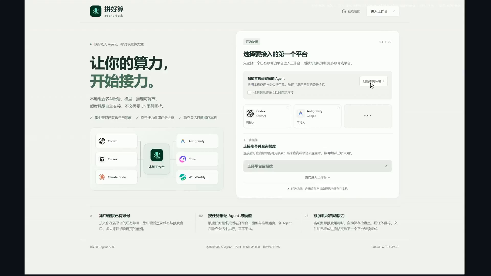
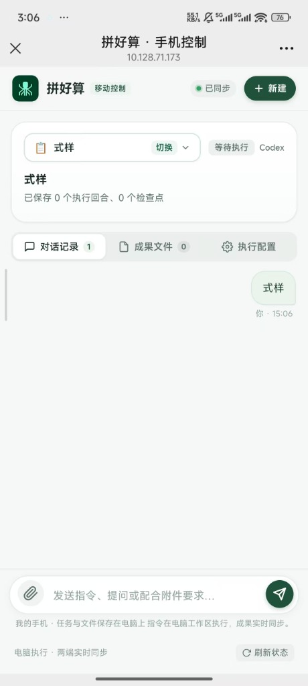
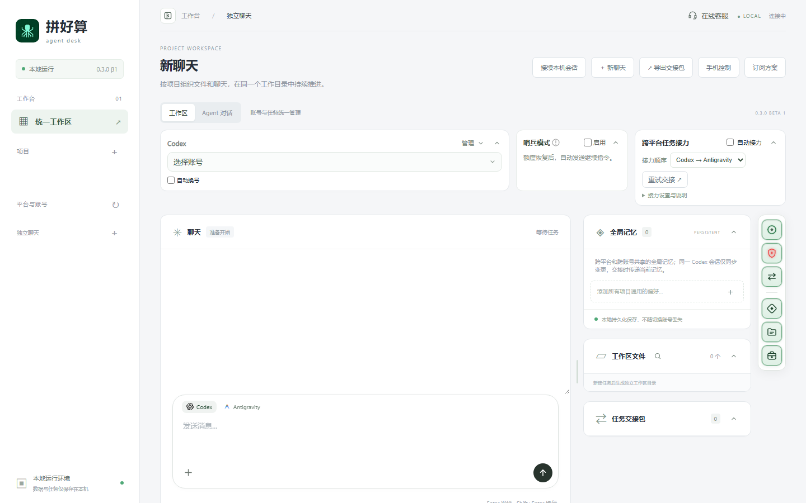
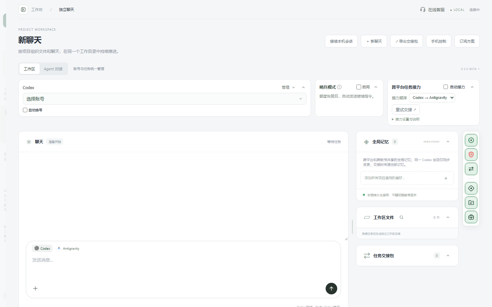

# 拼好算 Agent Desk (v0.3.0 正式版)

> **为开发者与 AI Agent 打造的本地专属工作台**  
> 本地任务持久化 · 智能额度哨兵 · 跨平台无损接力 · 手机远程协同 · 开放插件式架构

[](LICENSE)
[](package.json)
[](tests/)
[](#隐私与数据安全承诺)

---

## 项目契机与初心

我是南开大学大三的一名学生。这个项目的起点，是我在大学修读一门金融科技（FinTech）课程时的结课作业。课程要求我们寻找现实生活中真实存在的痛点，设计一款能切实帮到用户的商业产品。

当时我回想自己平时写代码、做课程作业时的经历，发现自己最大的困扰正是在使用 AI Agent 上：
每次推进一个复杂长任务，最麻烦的往往是**额度突然耗尽导致任务被迫中断，需要人一直守在电脑前手动换号、盯着进度**。离开电脑去吃个饭，完全不知道后台跑成什么样了。

坦白地说，**我只有最基础的代码读写能力**，整个项目绝大部分的代码实现与系统工程，都是我提出需求与交互构想，由 **Codex 与 Antigravity** 两位 AI 伙伴结对协同编写完成的。将这个项目开源，是希望能把这个真正解决了我自身痛点的想法与工具分享出来，切实帮到和我一样每天深度使用各类 Agent 的开发者与朋友们。

---

## 目标人群与解决的痛点

### 适合哪些人使用？
* **低成本账号用户**：手头有通过各类低价渠道、新手试用或拼车薅羊毛获取的账号，这类账号往往不够稳定且有效期短，需要尽快使用完额度；通过自动换号与接力，可以把这些分散的低成本额度充分利用起来推进大任务；
* **长任务深度使用者**：经常需要 Agent 持续分析代码、改写项目文件、整理交付物的开发者、学生与研究人员；
* **多平台探索用户**：同时使用 Codex、Antigravity、Claude 等不同工具，常常遇到额度受限或平台偶发故障，希望任务能够无损接力推进的人；
* **注重本地数据安全的人**：希望把所有项目代码、文件成果和对话数据牢牢留在本地硬盘，不希望经过第三方云端中转的人；
* **轻量远程监控需求者**：任务在电脑端后台运行，希望离开工位后能随时在手机上查看进度、投送资料或补充指令的人。

### 核心解决什么痛点？
1. **额度限制导致任务中断与人工坚守**：长任务推进中一旦遇到额度耗尽，进程立即停滞，需要人一直守在电脑前手动切换账号，无法安心挂机执行；
2. **多账号管理与频繁切换繁琐**：虽然备有多个账号，但在终端或浏览器中反复退登、重新授权耗时费力，打乱连续的工作心流；
3. **平台割裂与厂商绑定**：单一平台发生网络故障或服务受限时，缺乏顺畅的跨平台承接方式，已修改的代码与交付物难以直接继承；
4. **离机状态下长任务失控**：长耗时任务在电脑端运行，离开工位后便失去感知，无法在手机端查看结果或及时补充关键文件。

---

## 演示视频与最新界面展示

### 1. 核心工作流演示视频
[](https://www.bilibili.com/video/BV1Hf4E6fELs/)

> [!TIP]
> **[▶️ 点击上方封面或此处，前往哔哩哔哩观看完整实机演示视频（1080P 超清流畅）](https://www.bilibili.com/video/BV1Hf4E6fELs/)**  
> *视频主题：《为解决5H限额和利用低价订阅而生的AI工作台》*

* **操作版本说明**：该视频录制于 **v0.1 早期原型版本**，主要用于验证核心功能链路（本地任务建立、多轮对话推进、检查点保存以及额度耗尽时的换号与接力机制）。
* **当前版本演进**：当前发布的 **v0.3.0 正式版**在界面视觉、响应速度、移动端抽屉式体验以及自定义平台扩展性上，均已完成深度重构与全面演进。

---

### 2. v0.3.0 最新优化功能展示

针对日常高频使用中的细节与体验，v0.3.0 版本重点进行了以下优化：

#### 优化 1：响应链路与首字速度全面提升
* **精简前置重复流程**：重构了任务启动前繁复的环境与模型重复校验逻辑，去除每次交互前不必要的无效检查开销；
* **显著降低首字延迟**：指令回车即发，首字响应时间大幅缩短；优化流式分发缓冲，消除前几个字快、后续断断续续的吐字卡顿，让桌面与移动端的交互流畅度无限贴近原生终端标准。

#### 优化 2：移动端原生质感体验升级（半屏抽屉与快捷附件）
* **半屏毛玻璃任务抽屉**：彻底替换系统原生粗糙的下拉单选框。轻触顶部任务即可唤起半屏抽屉，卡片化呈现任务状态流转与检查点进度；
* **手机端随手上传附件**：支持在手机端点击回形针，快速拍照、上传数据表格或代码文件至电脑端当前任务工作区，协同推进长任务：

<p align="center">
  
  &nbsp;&nbsp;
  
</p>

#### 优化 3：桌面端交互视野与状态反馈升级（展开 / 收起双态）
左侧边栏支持一键收起与展开，可在“多任务全局掌控”与“沉浸式代码/成果审查”之间自由切换，同时集成各平台额度指示灯监控与哨兵自动调度：

* **边栏展开状态（全景任务管理与状态监控）**：


* **边栏收起状态（极致沉浸的交付成果阅读视野）**：


---

## 核心功能亮点

### 1. 真实工作区与任务检查点（Task Checkpoints）
- 每一个任务都对应本地独立的物理工作目录，代码和交付文件直接写入磁盘，不存黑盒。
- 每一轮执行自动记录文件变动哈希、消息序列与阶段检查点，断点随时可续。

### 2. 智能额度哨兵（Quota Sentinel）
- 自动解析官方 5 小时、每周、每月额度窗口及精确重置时间戳（北京时间）。
- 额度耗尽时，哨兵自动挂起等待计划并执行智能退避；一旦官方额度恢复，自动唤醒并继续未竟任务。

### 3. 跨平台无损任务接力（Cross-Platform Relay）
- 内置支持 Codex 与 Antigravity CLI 双向接力。
- 换号或换平台时，自动封装「交接包（Handoff Packet）」——继承工作区改动、任务目标、固定约束与未完成步骤，无需人工重新交代背景。

### 4. 全开放的自定义平台接入架构（Pluggable Providers）
拼好算采用抽象提供者架构，任何开发者（甚至是你的 AI Agent）都可以参考规范，在数十行代码内接入你偏好的任何平台：
- Claude Code CLI
- Cursor / Kiro / WorkBuddy
- 本地大模型（Ollama / vLLM / LocalAI）
- 自定义模型网关与企业内部服务

详细扩展教程请参考：[平台扩展与适配器开发指南 (docs/EXTENDING_PROVIDERS.md)](docs/EXTENDING_PROVIDERS.md)

### 5. AI Agent 开发者友好（Built-in Agent Skill）
项目随包内置了专为 AI 编码助手编写的协同技能：
`.agent/skills/agent-desk-guide/SKILL.md`
当你在 Cursor、Antigravity、Claude Code 或 Codex 中打开本项目时，你的 AI Agent 能瞬间理解项目拓扑、设计规范并协助你高效二次开发。

### 6. 手机端局域网与中继协同（Mobile Companion）
- 电脑端一键生成配对二维码，手机扫码即可加入。
- 支持手机端查阅对话、审批权限、暂停/恢复、发送指令与上传文件。

---

## 隐私与数据安全承诺

* **100% 运行于本地**：服务默认监听 `127.0.0.1:4317`，数据默认保存在本地目录。
* **零凭证上传**：绝不收集、上传用户的任何 API Key、Token、Cookie、代码或聊天内容至第三方服务器。
* **物理安全隔离**：不同任务、不同平台的执行环境相互隔离，权限模式严格受控（只读 / 工作区 / 完全访问）。

---

## 快速上手

### 1. 环境准备
- **Node.js**：`>= 22.13`（推荐 Node.js 22 LTS）
- **操作系统**：Windows 10/11、macOS 或 Linux
- 本机已安装你常用的 Agent CLI（如 `codex` 或 `agy`）

### 2. 安装与启动

```bash
# 1. 克隆代码仓库
git clone https://github.com/your-username/agent-desk.git
cd agent-desk

# 2. 安装依赖 (无复杂前端构建)
npm ci

# 3. 运行自动化测试 (184 项测试保证稳定)
npm test

# 4. 启动工作台
npm start
```

### 3. 开始使用
启动后打开浏览器访问：
`http://127.0.0.1:4317/workspace`

在页面左侧点击检测本机 Agent，根据提示接入你的官方 CLI 即可开始。

---

## 项目目录结构

```
agent-desk/
├── server.mjs             # 后台核心服务 (任务引擎 / 调度器 / 路由)
├── remote-relay.mjs       # 远程手机中继逻辑
├── lib/                   # 核心库
│   ├── codex.mjs          # Codex 适配器
│   ├── antigravity.mjs    # Antigravity 适配器
│   ├── local-agents.mjs   # 本地平台探测中心
│   ├── platform-relay.mjs # 跨平台上下文交接
│   ├── companion-server.mjs # 手机端配对与文件互传
│   ├── account-manager.mjs # 多账号管理与额度池
│   └── store.mjs          # 任务状态持久化
├── public/                # 纯原生 Web 前端 (零打包，即改即生效)
│   ├── index.html / app.js / style.css       # 电脑桌面端
│   └── mobile.html / mobile.js / mobile.css  # 手机移动端
├── docs/                  # 文档与截图
│   ├── showcase/          # 最新界面高清截图
│   ├── EXTENDING_PROVIDERS.md # 自定义平台开发指南
│   └── DEPLOYMENT.md      # 部署与配置说明
├── skills/                # 随包 Agent 协同技能
│   └── agent-desk-guide/  # AI 智能体开发参考技能
└── tests/                 # 184 项全量自动化测试套件
```

---

## 下一步优化目标

作为个人利用课余时间持续迭代的开源项目，拼好算仍有很多值得深入打磨的方向。接下来计划重点推进：

1. **开箱即用的跨网远程控制**：
   目前移动端协同主要依赖局域网（同一 Wi-Fi）直连。后续计划探索更便捷、安全的端到端加密跨网中继方案，免去用户自行搭建内网穿透或反向代理的繁琐步骤，实现在户外蜂窝网络下也能随时随地安全控制与监控家中的长任务；
2. **扩充内置平台适配库**：
   在现有的 Codex 与 Antigravity 基础上，推进官方内置 Claude Code、Cursor CLI 以及本地离线模型（如 Ollama、vLLM）的开箱即用适配器；
3. **多 Agent 协同分工与子任务编排**：
   支持更灵活的多 Agent 协同流水线（例如让擅长代码生成的 Agent 与负责文档整理、单元测试的 Agent 分工协作不同子任务）；
4. **额度与用量趋势可视化**：
   提供更直观的各账号 Token/窗口消耗速率与预警分析，更早预估断档时间，让自动换号与哨兵调度更具前瞻性。

---

## 参与贡献与二次开发

欢迎提交 Issue 或 Pull Request。无论是为我们贡献新的平台适配器（如 Claude Code、Ollama 等），还是改进界面细节与文档，我们都由衷感谢你的参与。

请确保在提交 PR 前运行并通过全量测试：
```bash
npm test
```

---

## 开源许可证

本项目基于 **GPL-3.0 License** 开源，详见 [LICENSE](LICENSE) 文件。
商业授权及其他合作请联系作者。
